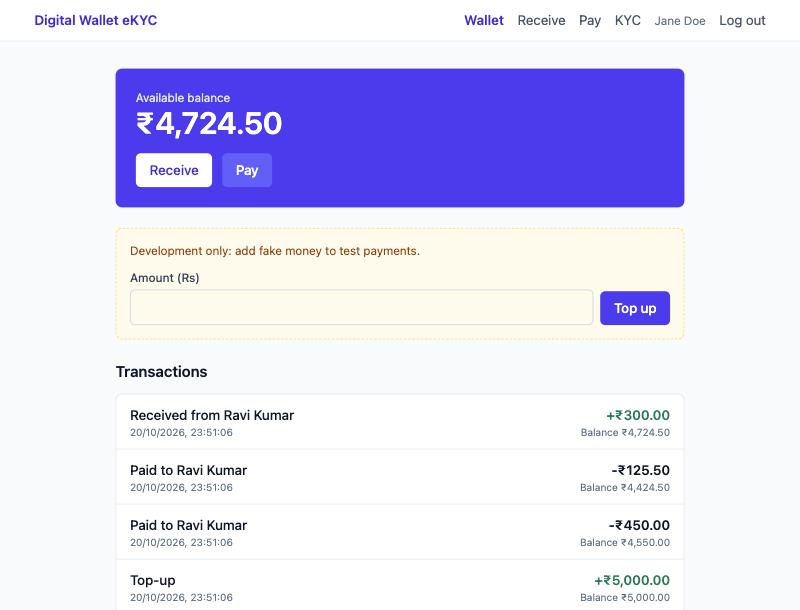
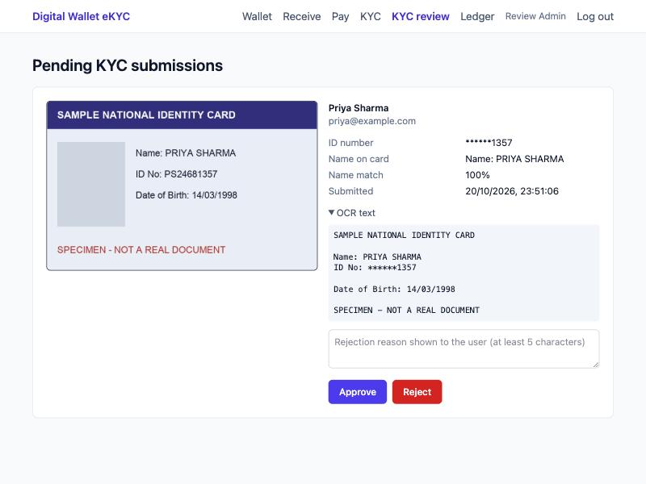
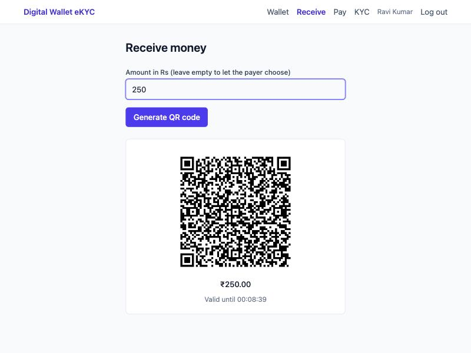
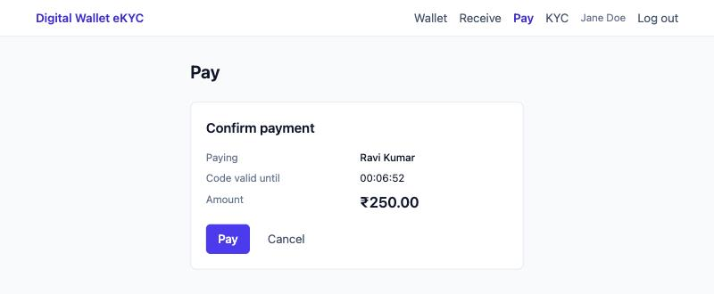
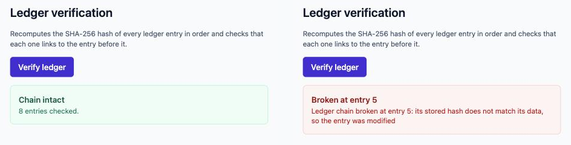
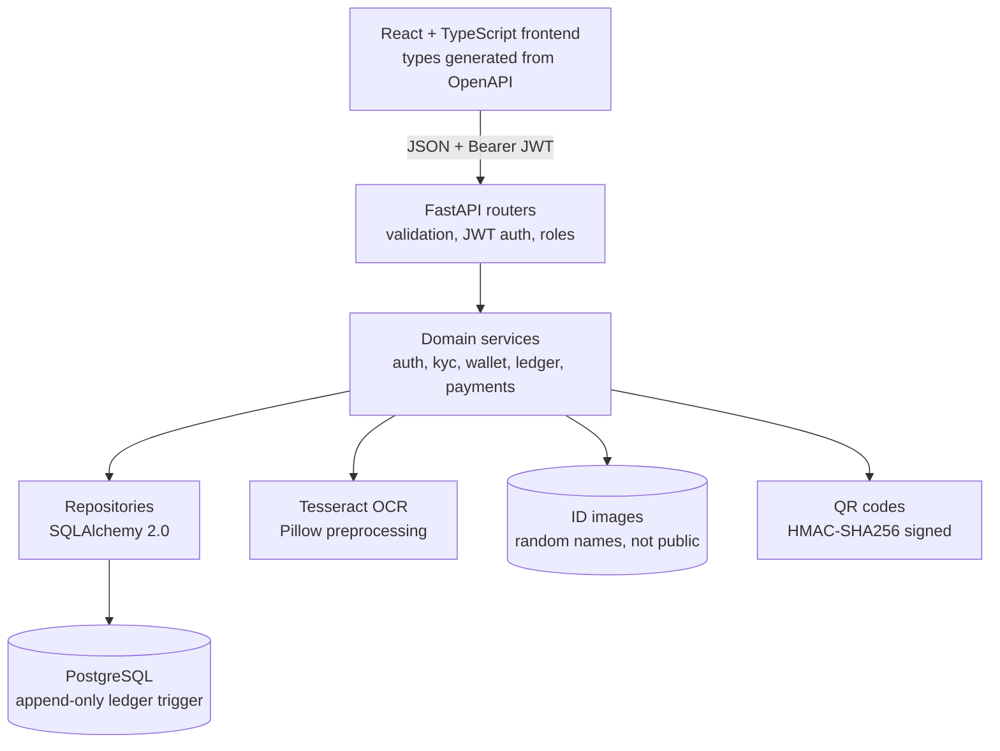
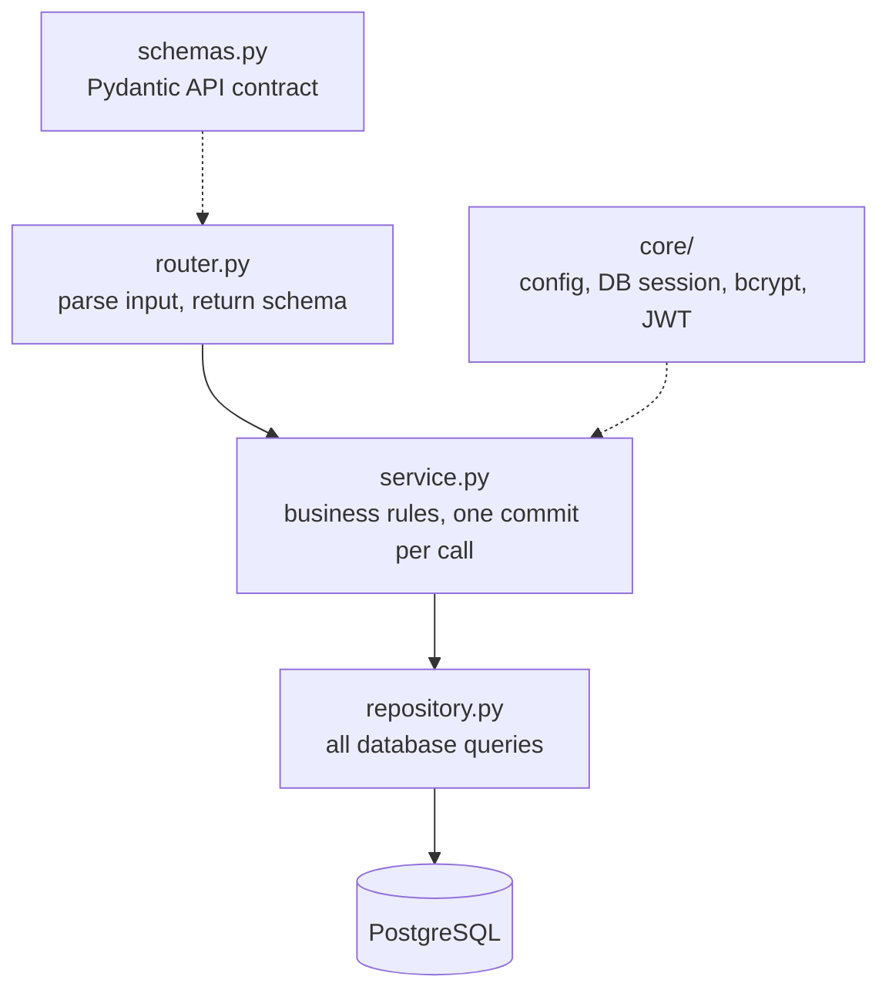
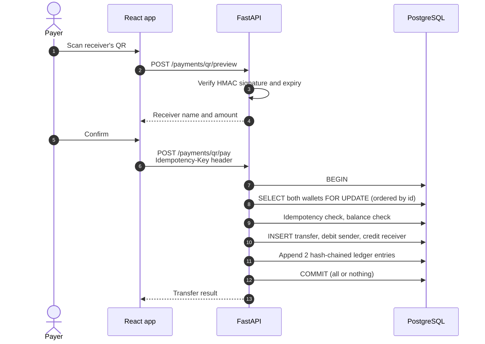
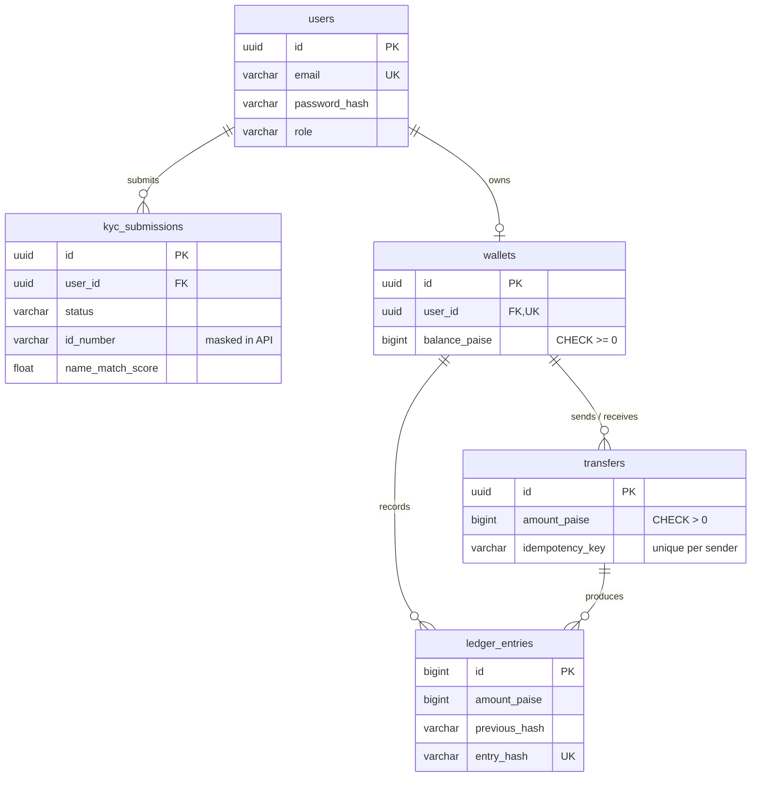

<div align="center">

# Digital Wallet & eKYC

**A full-stack digital wallet with OCR-based identity verification, atomic money transfers, a tamper-evident SHA-256 hash-chained ledger and signed QR payments.**


[Highlights](#highlights) · [Screenshots](#screenshots) · [Architecture](#architecture) · [Engineering decisions](#key-engineering-decisions) · [Quick start](#quick-start) · [Testing](#testing)

</div>

> All money in this project is fake. It is a portfolio proof of concept, not a production payment system.

## Highlights

- **eKYC with OCR.** Users upload an ID card. The backend preprocesses it (grayscale, upscaling, Otsu thresholding), reads it with Tesseract, extracts the ID number with a regex and fuzzy-matches the name against the registered one. An admin approves or rejects the submission.
- **Atomic, race-free transfers.** Both wallet rows are locked with `SELECT ... FOR UPDATE` in a fixed order, so concurrent payments cannot deadlock or overdraw. In a test of 20 simultaneous payments against a balance that could cover 10, exactly 10 succeeded and the balance ended at exactly zero.
- **Idempotent payments.** An `Idempotency-Key` header plus a unique database constraint mean a retried request never charges twice.
- **Tamper-evident ledger.** Every balance change is chained with SHA-256 to the previous entry. A Postgres trigger blocks `UPDATE` and `DELETE`, and an admin endpoint pinpoints the first modified entry.
- **Signed QR payments.** Payment requests are HMAC-SHA256 signed and expire. Altered or expired codes are rejected before any money moves.
- **Privacy by default.** ID numbers are masked to the last 4 characters in every API response and log line. ID images are stored under random names outside any public folder.
- **End-to-end type safety.** Frontend API types are generated from the backend's OpenAPI schema, so a renamed backend field fails the frontend build.
- **27 integration tests.** They run against a real PostgreSQL test database through the real Alembic migrations.

## Screenshots

<table>
  <tr>
    <td width="50%"></td>
    <td width="50%"></td>
  </tr>
  <tr>
    <td align="center"><b>Wallet</b>: balance, dev-only top-up and transaction history with counterparties</td>
    <td align="center"><b>Admin KYC review</b>: ID image, masked ID, OCR text and name match score</td>
  </tr>
  <tr>
    <td width="50%"></td>
    <td width="50%"></td>
  </tr>
  <tr>
    <td align="center"><b>Receive</b>: signed, expiring payment QR code</td>
    <td align="center"><b>Pay</b>: scan or upload a QR, then confirm the receiver and amount</td>
  </tr>
</table>

<p align="center">
  
  <br>
  <b>Ledger verification</b>: intact chain (left), and the exact entry detected after a row was edited directly in the database (right)
</p>

## Architecture

### System overview



### Backend layers

Each domain (`auth`, `kyc`, `wallet`, `ledger`, `payments`) is its own package under `backend/app/` with the same layers:



| Layer | Responsibility |
|---|---|
| `router.py` | Thin HTTP layer: parses input, calls one service function, returns a Pydantic schema |
| `service.py` | All business rules; decides when to commit, so one service call is one transaction |
| `repository.py` | The only place that talks to the database; flushes, never commits |
| `schemas.py` | Pydantic models, the single source of truth for the API contract |
| `models.py` | SQLAlchemy table definitions |

### A QR payment, end to end



### Data model



Full details: [docs/architecture.md](docs/architecture.md) · [docs/data-model.md](docs/data-model.md) · [docs/security-review.md](docs/security-review.md)

## Key engineering decisions

| Problem | Solution |
|---|---|
| Two payments from the same wallet at the same moment could both pass the balance check | `SELECT ... FOR UPDATE` on both wallet rows, plus `CHECK (balance_paise >= 0)` as a database backstop |
| Two transfers locking the same wallets in opposite order would deadlock | Wallets are always locked in ascending id order |
| A crash between the debit and the credit would lose money | Debit, credit, transfer row and ledger entries share one transaction that commits once |
| A network retry could charge the payer twice | `Idempotency-Key` header, unique per sender, checked after the wallet lock is held |
| Floating point cannot represent 0.10 exactly | All amounts are integer paise in `BIGINT` columns; the frontend parses rupees as text |
| Ledger history could be edited silently | SHA-256 hash chain, verification endpoint, and a trigger that rejects `UPDATE` and `DELETE` |
| Concurrent ledger appends could fork the chain | A transaction-scoped Postgres advisory lock serializes appends |
| A QR code could be altered to change the amount or receiver | HMAC-SHA256 signature with a dedicated key, constant-time comparison, expiry inside the signed payload |
| Two KYC uploads could race past the "one active submission" rule | Partial unique index on `user_id WHERE status IN ('PENDING', 'VERIFIED')` |
| Response timing could reveal which emails are registered | Unknown emails are still checked against a placeholder bcrypt hash |
| Frontend and backend types drift apart | TypeScript types generated from FastAPI's OpenAPI schema |

## Tech stack

| Area | Technologies |
|---|---|
| Backend | Python 3.11, FastAPI, Pydantic v2, SQLAlchemy 2.0, Alembic |
| Security | bcrypt, PyJWT (HS256), HMAC-SHA256, SHA-256 hash chain |
| OCR and imaging | Tesseract (pytesseract), Pillow, qrcode |
| Database | PostgreSQL 16 via Docker Compose, separate development and test databases |
| Frontend | React 19, TypeScript (strict), Vite, React Router, Tailwind CSS, html5-qrcode |
| Tooling | openapi-typescript, pytest, httpx |

## Quick start

**Prerequisites:** Docker Desktop, Python 3.11+, Node.js 20+, and Tesseract OCR 5.

| OS | Install Tesseract |
|---|---|
| macOS | `brew install tesseract` |
| Ubuntu / Debian | `sudo apt install tesseract-ocr` |
| Windows | Run the installer from https://github.com/UB-Mannheim/tesseract/wiki and add `C:\Program Files\Tesseract-OCR` to `PATH` |

**1. Configure and start the databases** (project root)

```bash
cp .env.example .env
docker compose up -d
```

In `.env`, set `JWT_SECRET_KEY` and `QR_SIGNING_KEY` to two different values from `openssl rand -hex 32`. On Windows PowerShell use `Copy-Item .env.example .env`.

**2. Run the backend** (`backend/`)

```bash
python3 -m venv .venv
source .venv/bin/activate
pip install -r requirements.txt
alembic upgrade head
uvicorn app.main:app --reload
```

On Windows activate with `.venv\Scripts\Activate.ps1`. API: http://localhost:8000 · interactive docs: http://localhost:8000/docs

**3. Create an admin** (`backend/`, virtual environment active)

```bash
python -m scripts.create_admin --name "Admin User" --email admin@example.com --phone 9000000000
```

The password is typed twice at a hidden prompt; admins cannot sign up through the API.

**4. Run the frontend** (`frontend/`)

```bash
npm install
npm run dev
```

App: http://localhost:5173

<details>
<summary><b>Environment variables</b></summary>

| Variable | Purpose |
|---|---|
| `POSTGRES_USER`, `POSTGRES_PASSWORD`, `POSTGRES_DB`, `POSTGRES_TEST_DB` | Docker Compose database credentials and names |
| `DATABASE_URL` | Development database (port 5432) |
| `TEST_DATABASE_URL` | Test database (port 5433) |
| `JWT_SECRET_KEY`, `JWT_ALGORITHM`, `JWT_EXPIRE_MINUTES` | Access token signing and lifetime |
| `CORS_ORIGIN` | The single browser origin allowed to call the API |
| `UPLOAD_DIR`, `MAX_UPLOAD_BYTES` | ID image storage folder (relative to `backend/`) and size limit |
| `ENABLE_DEV_TOPUP` | `true` enables the fake-money top-up endpoint; keep `false` outside development |
| `QR_SIGNING_KEY`, `QR_EXPIRE_MINUTES` | QR payment request signing key and lifetime |
| `VITE_API_URL` | API base URL used by the frontend |

</details>

<details>
<summary><b>Demo walkthrough</b></summary>

1. Register a user whose name matches the fake ID card, for example `Jane Doe`.
2. Upload an ID image containing lines such as `Name: JANE DOE` and `ID No: AB12345678`. The status page shows PENDING, the masked ID and the name match score.
3. In a private window, log in as the admin, open **KYC review** and approve. This opens the user's wallet.
4. As the user, open **Wallet** and top up some fake money.
5. Register and verify a second user. As that user, open **Receive** and generate a QR code.
6. As the first user, open **Pay**, scan or upload the QR, confirm and pay. Both wallets update.
7. As the admin, open **Ledger** and click **Verify ledger** to see "Chain intact".

</details>

## Testing

```bash
cd backend
pytest -v
```

The suite runs the real Alembic migrations against the PostgreSQL test database, empties every table before each test, and mocks only the Tesseract call.

| Area | What is tested |
|---|---|
| Auth | Registration, duplicate email, login, wrong password, missing token, expired token |
| KYC | Upload creates PENDING, admin approve and reject, resubmission blocked while pending and allowed after rejection |
| Access control | A normal user is refused on every admin endpoint |
| Payments | Blocked before KYC, successful payment with history, insufficient balance, expired QR, tampered QR, idempotent retry |
| Atomicity | A simulated crash after the debit leaves balances and history unchanged |
| Ledger | Chain verifies as intact, trigger rejects `UPDATE` and `DELETE`, tampering is detected at the exact entry |

The frontend production build (`npm run build`) runs a strict TypeScript check before bundling.

## API overview

| Method | Endpoint | Access | Purpose |
|---|---|---|---|
| POST | `/auth/register` | Public | Create a user account |
| POST | `/auth/login` | Public | Exchange credentials for a JWT |
| GET | `/auth/me` | User | Current user |
| POST | `/kyc/submissions` | User | Upload an ID image for OCR and review |
| GET | `/kyc/submissions/me` | User | Latest KYC submission and status |
| GET | `/wallet` | Verified user | Balance and wallet details |
| GET | `/wallet/transactions` | Verified user | Ledger entries with counterparties |
| POST | `/wallet/top-up` | Verified user | Add fake money (dev flag only) |
| POST | `/payments/qr` | Verified user | Create a signed payment QR |
| POST | `/payments/qr/preview` | Verified user | Verify a QR and show the receiver |
| POST | `/payments/qr/pay` | Verified user | Pay a QR (requires `Idempotency-Key`) |
| GET | `/admin/kyc/submissions` | Admin | List submissions by status |
| GET | `/admin/kyc/submissions/{id}/image` | Admin | View an uploaded ID image |
| POST | `/admin/kyc/submissions/{id}/approve` | Admin | Approve and open the wallet |
| POST | `/admin/kyc/submissions/{id}/reject` | Admin | Reject with a reason |
| GET | `/admin/ledger/verify` | Admin | Verify the ledger hash chain |

## Project structure

```
digital-wallet-ekyc/
├── backend/
│   ├── app/
│   │   ├── core/        config, database session, bcrypt and JWT helpers
│   │   ├── auth/        registration, login, current-user and admin dependencies
│   │   ├── kyc/         ID upload, OCR pipeline, admin review
│   │   ├── wallet/      wallets, top-up, atomic transfers
│   │   ├── ledger/      hash-chained ledger and verification
│   │   └── payments/    signed QR payment requests
│   ├── alembic/         migrations, including the append-only trigger
│   ├── scripts/         create_admin.py
│   └── tests/           pytest suite
├── frontend/
│   └── src/
│       ├── api/         typed API client and generated schema.ts
│       ├── components/  shared UI components
│       └── features/    auth, kyc, wallet, payments, ledger pages
├── docs/                architecture, data model, security review, screenshots
└── docker-compose.yml   development and test PostgreSQL databases
```

## Security

The full review in [docs/security-review.md](docs/security-review.md) walks through every OWASP Top 10 category, how personal data is handled, and what would change for production. In short, production would add:
- an httpOnly cookie with CSRF protection instead of sessionStorage for the JWT;
- encrypted document storage;
- rate limiting;
- orphan file cleanup;
- HTTPS with security headers;
- external anchoring of the ledger hash.

## License

Released under the [MIT License](LICENSE).

## Author

Built by [SanchitSlayer](https://github.com/SanchitSlayer).
