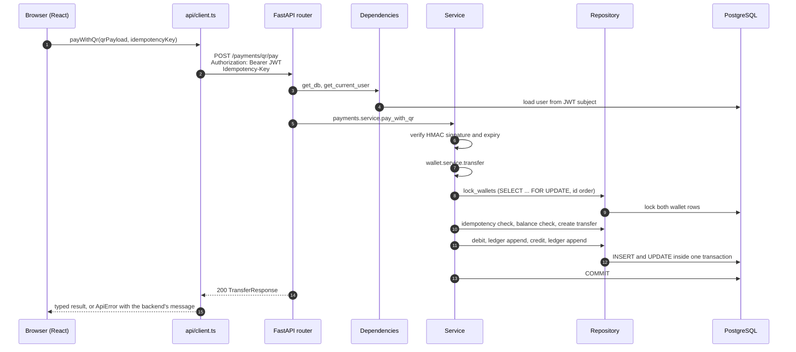
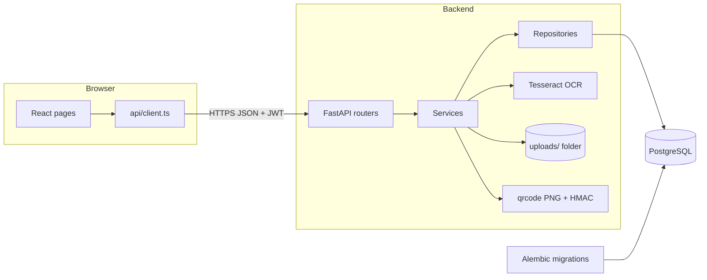

# Architecture

## Components

| Component | Technology | Responsibility |
|---|---|---|
| Frontend | React, TypeScript, Vite, React Router, Tailwind CSS | Pages for registration, login, KYC, wallet, QR receive and pay, and admin review. Calls the API only through `frontend/src/api/`. |
| API | FastAPI, Pydantic v2 | HTTP endpoints, request validation, authentication and authorization. |
| Domain services | Python | Business rules for auth, KYC, wallets, the ledger and QR payments. |
| Repositories | SQLAlchemy 2.0 | All database reads and writes. |
| Database | PostgreSQL 16 (Docker) | Users, KYC submissions, wallets, transfers and the append-only ledger. |
| Migrations | Alembic | Versioned schema changes, including the ledger's append-only trigger. |
| OCR | Tesseract via pytesseract, Pillow | Image preprocessing and text extraction for ID cards. |
| File storage | Local folder `backend/uploads/` | Uploaded ID images under random names, never served publicly. |

## Backend layout

Each domain lives in its own package under `backend/app/`, and every package uses the same layers:

```
app/
  core/       config.py, database.py, security.py
  auth/       users, registration, login, current-user and admin dependencies
  kyc/        ID upload, OCR, admin review
  wallet/     wallets, top-up, atomic transfers
  ledger/     hash-chained ledger and verification
  payments/   signed QR payment requests
```

| Layer | Rule |
|---|---|
| `router.py` | Parses input, calls one service function, and returns a Pydantic schema. No business logic. |
| `service.py` | Holds all business rules and decides when to commit the transaction. |
| `repository.py` | The only place that queries the database. Repositories flush; they never commit. |
| `schemas.py` | Pydantic request and response models, the single source of truth for the API contract. |
| `models.py` | SQLAlchemy table definitions. |

Cross-domain calls go service to service (or service to another domain's repository), never router to router. For example, approving KYC calls `wallet.service.open_wallet` inside the same transaction.

## Frontend layout

```
frontend/src/
  api/         client.ts (the only fetch call), schema.ts (generated), one module per domain
  components/  shared UI: NavBar, ProtectedRoute, FormField, ErrorMessage, SubmitButton
  features/    auth, kyc, wallet, payments, ledger
```

`src/api/schema.ts` is generated from the backend's OpenAPI document with `npm run generate:api`, so frontend request and response types always match the backend's Pydantic schemas.

## Request flow



## System overview



## Key flows

**Registration and login.** The password is hashed with bcrypt and stored. Login verifies the hash and returns a JWT signed with `JWT_SECRET_KEY` that expires after `JWT_EXPIRE_MINUTES`. Every protected request decodes the token and reloads the user from the database.

**eKYC.** The upload is size-checked and decoded with Pillow to confirm it is a real JPEG or PNG. The image is converted to grayscale, upscaled if small, binarized with an Otsu threshold, and read by Tesseract. A regex extracts the ID number and `difflib` scores the name against the registered name. The ID is masked inside the stored OCR text, the image is saved under a random name, and a PENDING submission is created. An admin approves (which opens the wallet) or rejects with a reason.

**Transfers.** Both wallet rows are locked in ascending id order, the idempotency key is checked, the balance is checked, and the debit, credit and two ledger entries are written in one transaction that commits once.

**Ledger.** Each entry stores `SHA-256(previous_hash + canonical JSON of the entry)`. Appends take a transaction-scoped Postgres advisory lock so the chain never forks. A database trigger rejects UPDATE and DELETE. The admin verification endpoint walks the chain from the genesis hash and reports the first broken entry.

**QR payments.** The receiver gets a QR containing `base64url(payload).base64url(HMAC-SHA256)`, where the payload holds the wallet id, an optional amount and an expiry. The payer's app decodes the QR, the backend verifies it and returns the receiver's name for confirmation, and the pay endpoint verifies it again before calling the transfer service.
