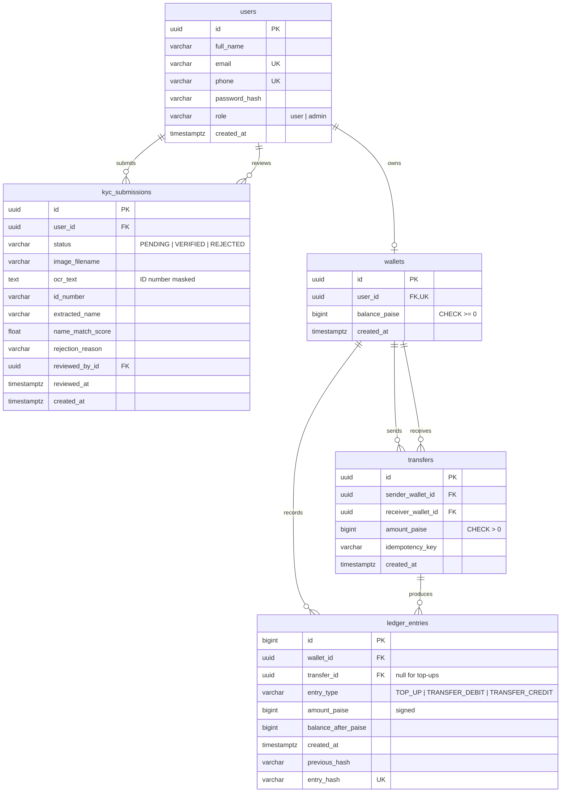

# Data Model

All tables are created by Alembic migrations in `backend/alembic/versions/`. Primary keys are UUIDs, except `ledger_entries`, which uses a sequential identity column because the hash chain needs a strict order. All timestamps are timezone-aware. Money is stored as integer paise in `BIGINT` columns.

## Entity relationship diagram

## Tables

### users
| Column | Notes |
|---|---|
| `id` | UUID primary key. |
| `email` | Unique, stored lowercase. |
| `phone` | Unique, 10 to 15 digits with optional leading `+`. |
| `password_hash` | bcrypt hash (60 characters). The plaintext password is never stored. |
| `role` | `user` or `admin`, stored as text with a CHECK constraint so new roles do not need an `ALTER TYPE`. |

### kyc_submissions
One row per attempt, so rejected history is kept.

| Column | Notes |
|---|---|
| `user_id` | Foreign key to `users`, indexed. |
| `status` | `PENDING`, `VERIFIED` or `REJECTED`. |
| `image_filename` | Random name of the file in `backend/uploads/`. |
| `ocr_text` | Tesseract output with the ID number already masked. |
| `id_number` | Full extracted ID number. Masked in every API response and log line. |
| `name_match_score` | 0 to 100 similarity between the registered name and the best matching OCR line. |
| `reviewed_by_id` | Foreign key to the admin in `users`. |

Constraint: partial unique index `uq_kyc_submissions_one_active_per_user` on `user_id` where `status IN ('PENDING', 'VERIFIED')`, so a user has at most one active submission but any number of rejected ones.

### wallets
| Column | Notes |
|---|---|
| `user_id` | Unique foreign key: one wallet per user. The row is created when KYC is approved. |
| `balance_paise` | `CHECK (balance_paise >= 0)`. |

### transfers
| Column | Notes |
|---|---|
| `sender_wallet_id`, `receiver_wallet_id` | Foreign keys to `wallets`, both indexed. `CHECK (sender_wallet_id <> receiver_wallet_id)`. |
| `amount_paise` | `CHECK (amount_paise > 0)`. |
| `idempotency_key` | Unique together with `sender_wallet_id`, so a retried payment cannot be applied twice. |

### ledger_entries
Append-only record of every balance change.

| Column | Notes |
|---|---|
| `id` | `BIGINT` identity. Defines the chain order. |
| `transfer_id` | Foreign key to `transfers`, null for top-ups. Each transfer produces one debit and one credit entry. |
| `amount_paise` | Signed: positive for money in, negative for money out. |
| `balance_after_paise` | Wallet balance immediately after this entry. |
| `previous_hash` | `entry_hash` of the previous entry, or 64 zeros for the first entry. |
| `entry_hash` | `SHA-256(previous_hash + canonical JSON of wallet_id, transfer_id, entry_type, amount_paise, balance_after_paise, created_at)`. Unique. |

Trigger: `ledger_entries_append_only` runs `BEFORE UPDATE OR DELETE ... FOR EACH ROW` and raises an exception, so existing entries cannot be changed or removed through SQL.

## Migrations

| Revision | Creates |
|---|---|
| `0001` | `users` |
| `0002` | `kyc_submissions` and its partial unique index |
| `0003` | `wallets`, `transfers`, `ledger_entries`, the append-only trigger, and wallets for users already verified in Phase 1 |
